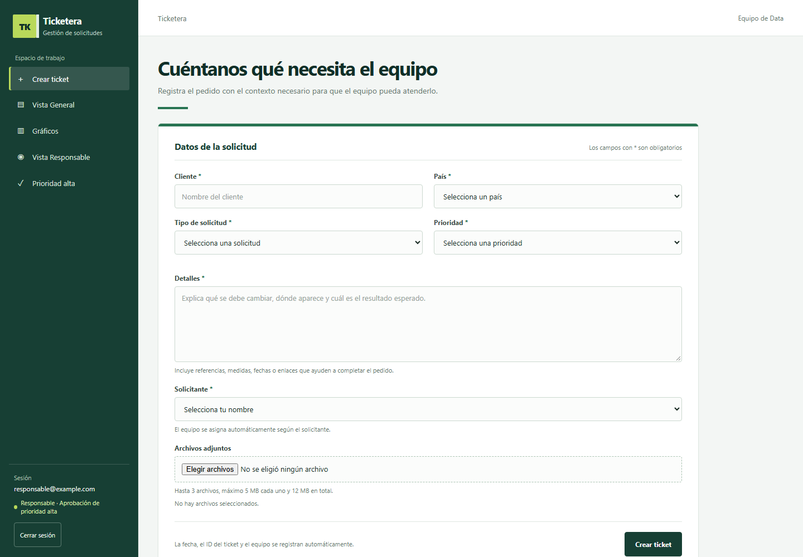
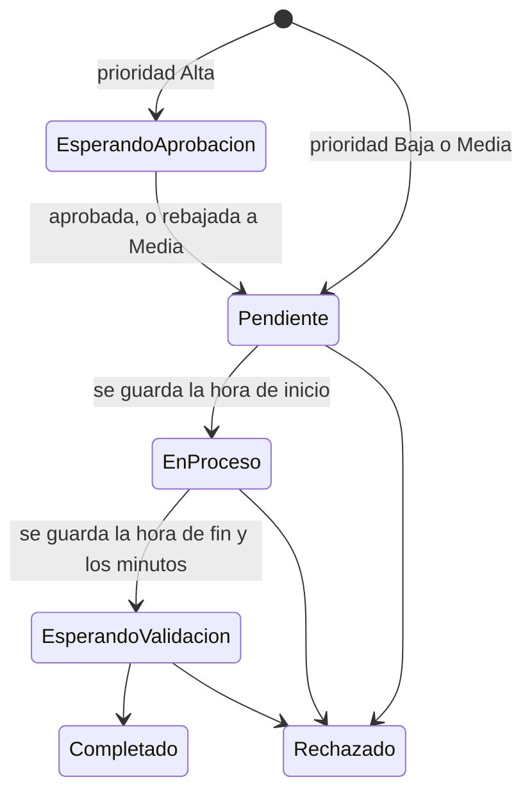
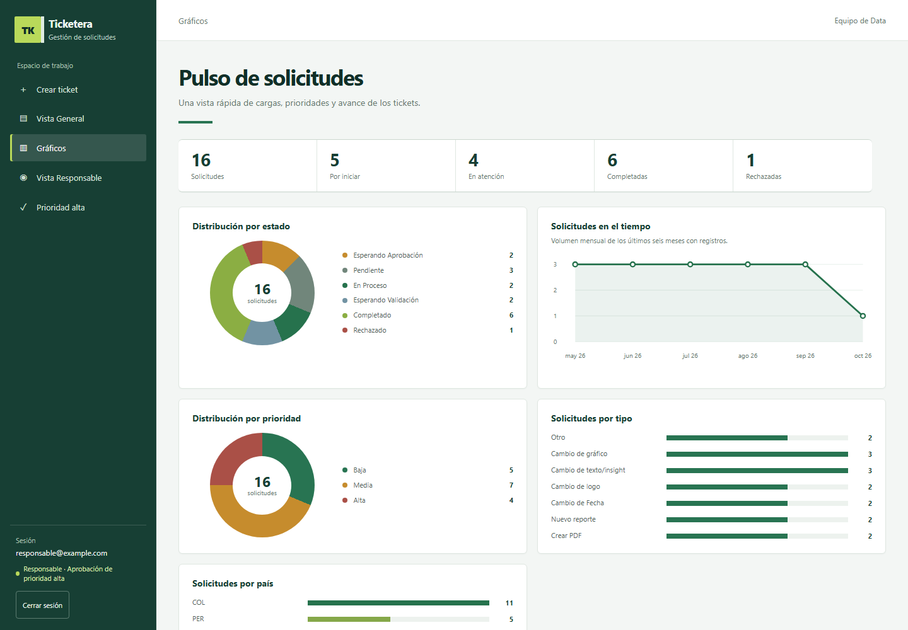
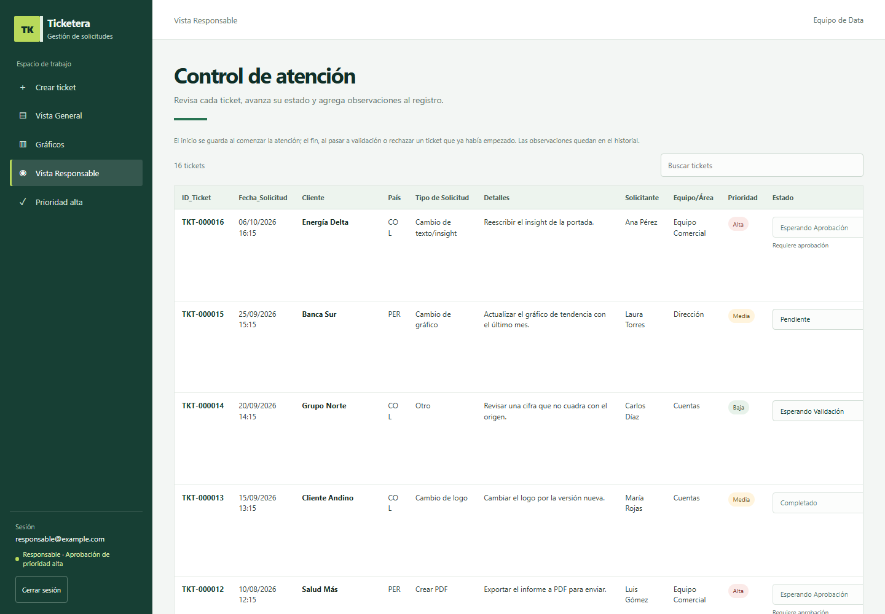

# Ticketera para el equipo de Data (Google Apps Script)

Aplicación web hecha con **Google Apps Script** para ordenar los requerimientos que llegan a un equipo
de Data: cambios en reportes, nuevos informes, PDFs, etc. Cada pedido queda como un ticket con su
historial, sus tiempos de atención y sus adjuntos. Las prioridades altas pasan por una aprobación antes
de empezar.

Todo corre en Google Workspace, sin servidores propios: una **hoja de cálculo** guarda los tickets,
una **carpeta de Drive** guarda los adjuntos y **MailApp** envía los avisos.



## Roles

| Rol | Qué puede hacer |
|---|---|
| **Solicitante** | Crea tickets con adjuntos y consulta el estado de todos en la Vista General y en Gráficos. |
| **Aprobador** | Recibe un correo por cada ticket de prioridad **Alta** y lo aprueba o lo baja a Media, desde el correo o desde la vista *Prioridad alta*. |
| **Responsable** | Recibe un correo por cada ticket nuevo, avanza su estado y deja observaciones, que se guardan con fecha y autor. |

Los permisos se comprueban **en el servidor** en cada llamada, no solo ocultando botones en la página.

## Ciclo de vida de un ticket



El servidor solo acepta esas transiciones, así que un ticket no puede saltarse pasos ni volver atrás.



## Inicio de sesión con correo y contraseña

La aplicación se publica para que la abra cualquiera con el enlace, sin cuenta de Google, y tiene su
propio control de acceso:

1. **Las contraseñas nunca se guardan.** Por cada cuenta solo se guarda un `salt` aleatorio y el
   resultado de **PBKDF2-SHA256** (60.000 iteraciones). Se generan con
   [`herramientas/generar_cuenta.html`](herramientas/generar_cuenta.html), que funciona sin conexión.
2. **La contraseña tampoco viaja.** El servidor entrega un reto de un solo uso, que caduca a los 3
   minutos. El navegador calcula PBKDF2 y firma el reto con **HMAC-SHA256**, y solo envía esa firma.
3. **Sesión firmada.** Si la firma cuadra, el servidor emite un token `payload.firma` (HMAC con un
   secreto guardado en las propiedades del script), que caduca a las 12 horas.
4. **Defensas:**
   - el mismo mensaje de error para un correo inexistente y para una clave incorrecta, con un `salt` y
     un `hash` de relleno para que la respuesta no delate qué cuentas existen;
   - bloqueo de 15 minutos tras 5 intentos fallidos;
   - comparación de firmas en tiempo constante.

## Otros detalles

- **Concurrencia:** `LockService` evita que dos tickets creados a la vez reciban el mismo ID (`TKT-000001`...).
- **Adjuntos:** se limitan a 3 archivos, 5 MB cada uno y 12 MB en total. Si falla el guardado del
  ticket, los archivos ya subidos a Drive se envían a la papelera.
- **Inyección de fórmulas:** el texto que empieza por `=`, `+`, `-` o `@` se guarda como texto en la
  hoja, no como fórmula.
- **Correos HTML** con botones *Aprobar* / *No aprobar*. El enlace abre la aplicación, pide iniciar
  sesión si hace falta y confirma la decisión.
- **Esquema protegido:** si los encabezados de la hoja no coinciden con los esperados, la aplicación
  no escribe nada.



*Las capturas usan datos inventados.*

## Estructura

```
src/
  Code.gs            servidor: configuración, tickets, aprobaciones, correos y acceso
  Index.html         interfaz completa (HTML + CSS + JS, sin librerías externas)
  appsscript.json    manifiesto: zona horaria, permisos y publicación como aplicación web
herramientas/
  generar_cuenta.html   genera el salt y el hash de cada cuenta en el navegador
```

## Instalación

1. Crea una hoja de cálculo de Google y abre **Extensiones → Apps Script**.
2. Copia el contenido de los archivos:
   - `src/Code.gs` va en `Code.gs`;
   - `src/Index.html` va en un archivo HTML llamado `Index`;
   - `src/appsscript.json` va en el manifiesto. Para verlo, activa en *Configuración del proyecto*
     la opción *Mostrar el archivo de manifiesto "appsscript.json"*.
3. Ajusta `CONFIG` en `Code.gs`:
   - el correo del responsable y de los aprobadores;
   - los solicitantes con su equipo;
   - los países y los tipos de solicitud.
4. Abre `herramientas/generar_cuenta.html` en el navegador. Genera una línea por cada persona, con
   sus roles, y pégala en `CONFIG.ACCOUNTS`. Genera también los valores `DUMMY_*`.
5. Recarga la hoja y ejecuta **Ticketera → Configurar ticketera**. Esa opción:
   - crea la pestaña `Tickets` con sus validaciones;
   - crea la carpeta de adjuntos;
   - genera el secreto de las sesiones.
6. Ve a **Implementar → Nueva implementación → Aplicación web**. Elige *Ejecutar como: yo* y
   *Quién tiene acceso: cualquier usuario*, y comparte el enlace.

## Tecnologías

Google Apps Script (V8) · SpreadsheetApp · DriveApp · MailApp · CacheService · LockService ·
PropertiesService · Web Crypto API · HTML/CSS/JavaScript sin dependencias.

## Licencia

[MIT](LICENSE)
